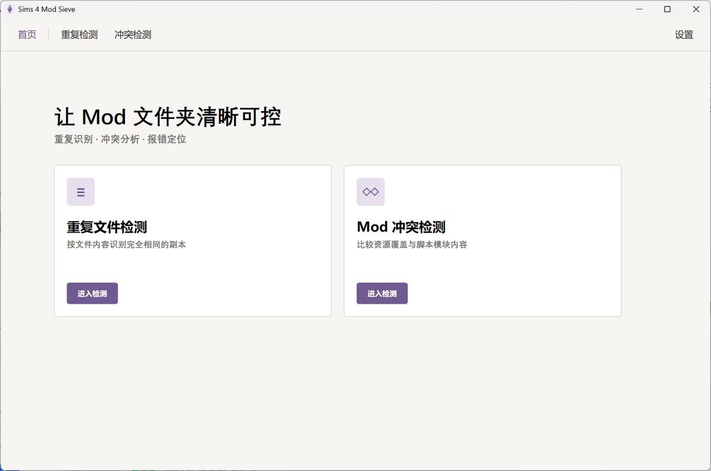

# Sims 4 Mod Sieve

[](https://github.com/stella-wood/Sims4ModSieve/actions/workflows/ci.yml)
[](https://github.com/stella-wood/Sims4ModSieve/releases)
[](./LICENSE)

把乱糟糟的 Mods 过一遍筛子。

Sims 4 Mod Sieve 是一个给《模拟人生 4》玩家用的 Windows 小工具，帮你找出重复的 Mod 文件、排查 Mod 之间的冲突，并且可以安全地禁用或删除它们。扫描和文件处理在本机完成，启动时联网检查工具更新。

> 本工具永久免费，只在 GitHub 发布。如果你是付钱买到它的，你被骗了。



## 功能

**重复文件检测**

- 扫描一个或多个文件夹里的 `.package` 和 `.ts4script`
- 找出文件名不同、内容完全相同的副本
- 自动给出建议保留和建议删除，可以逐个、按组或一键处理
- 删除的文件进入 Windows 回收站，最近一次删除可以撤回

**Mod 冲突检测（基础排查）**

- 比较 package 资源和脚本模块，找出互相覆盖的 Mod
- 按资源或模块分组展示，列出涉及哪些文件、为什么冲突
- 需要时可以展开技术详情
- 可以逐个文件删除或禁用

**禁用与恢复**

- 禁用是原地禁用，文件不移动、不删除
- 在「设置 → 删除与忽略」里可以单个、批量或全部恢复
- 支持忽略名单，把不想再看到的文件排除在外

报错日志分析、健康性检查、二分排查等功能还在开发中。

## 下载与使用

1. 打开 [Releases](https://github.com/stella-wood/Sims4ModSieve/releases)，下载最新版本的 `Sims4ModSieve-版本号-win-x64.zip`
2. 解压到一个单独的文件夹
3. 进入解压出来的文件夹，双击 `Sims4ModSieve.exe`

便携版自带运行环境，不需要另外安装 .NET。解压后请保留文件夹里的所有文件，不要只拷走 exe。

可以用同一页下载的 `.sha256` 文件核对压缩包有没有损坏。

### 第一次运行时 Windows 拦截了怎么办

程序还没有代码签名，Windows SmartScreen 可能会提示「Windows 已保护你的电脑」。点 **更多信息**，再点 **仍要运行** 即可。

### 系统要求

- Windows 10 或 Windows 11（x64）

## 安全与隐私

- 扫描、分析、生成报告全部在本机完成；程序启动时会向 GitHub 查询一次最新版本号，不上传 Mod、路径或报告
- 不执行 `.ts4script` 里的代码，不修改 package 内部内容
- 删除一律进入回收站，没有永久删除
- 删除和禁用前会再次核对文件，防止误操作扫描后被改动过的文件
- 配置和日志保存在 `%LOCALAPPDATA%\Sims4ModSieve\`，不会写进 Mods 文件夹

导出的报告可能包含你电脑上的完整路径，分享前请自己检查一下。

### 卸载

如果有禁用中的 Mod，请先在「设置 → 删除与忽略」里恢复，再删除程序文件夹。详细步骤见 [便携版使用说明 · 卸载](docs/release/便携版使用说明.md#卸载)。

## 常见问题

**扫描好慢？**
文件很多时扫描需要一些时间，请耐心等待。性能优化在计划中。

**禁用以后 Mod 去哪了？**
还在原来的位置，只是游戏暂时不会读取它。在设置里恢复就回来了。

**发现 bug 或者有建议？**
欢迎在 [Issues](https://github.com/stella-wood/Sims4ModSieve/issues) 里反馈。附上「设置 → 诊断与反馈」里复制的版本和系统信息会更好排查。

## 从源码构建

需要 .NET SDK 10.0.403 或兼容的 .NET 10 SDK（版本由 `global.json` 固定）。`eng\dotnet.cmd` 会优先使用项目内的本地 SDK，找不到时使用系统的 `dotnet`。

```powershell
.\eng\dotnet.cmd restore .\Sims4ModSieve.sln --locked-mode
.\eng\dotnet.cmd build .\Sims4ModSieve.sln -c Release --no-restore --nologo -m:1
.\eng\dotnet.cmd test .\Sims4ModSieve.sln -c Release --no-build --no-restore --nologo -m:1
```

每次推送到 `main` 或提交 Pull Request，GitHub Actions 会在 Windows 上执行同样的还原、构建和测试；失败时上传 `test-failure-diagnostics` 工件（测试结果和界面截图，保留 7 天）。

真实 Windows 回收站往返测试默认跳过，因为它会对自动生成的临时文件执行一次回收站删除和恢复（不会访问真实 Mods 文件夹）。需要验证时运行：

```powershell
$env:SIMS4_MOD_SIEVE_RUN_RECYCLE_BIN_TEST='1'
.\eng\dotnet.cmd test .\tests\Sims4ModSieve.Desktop.Tests\Sims4ModSieve.Desktop.Tests.csproj `
  -c Release --no-build --no-restore --nologo `
  --filter 'FullyQualifiedName~UnicodeFileCanRoundTripThroughWindowsRecycleBin'
```

运行桌面版：

```powershell
.\eng\dotnet.cmd run --project .\src\Sims4ModSieve.Desktop\Sims4ModSieve.Desktop.csproj -c Release
```

打包便携版（需要 PowerShell 7）：

```powershell
pwsh -NoProfile -File .\eng\package-portable.ps1
```

产物在 `artifacts/release/`。完整的发布流程见 [便携版发布流程](docs/release/便携版发布流程.md)。

### 命令行（CLI）

CLI 只扫描和导出报告，不会删除或修改文件。

```powershell
.\eng\dotnet.cmd run --project .\src\Sims4ModSieve.Cli\Sims4ModSieve.Cli.csproj -c Release -- `
  scan-duplicates `
  --source "D:\Documents\Electronic Arts\The Sims 4\Mods" `
  --mods-root "D:\Documents\Electronic Arts\The Sims 4\Mods" `
  --extension .package `
  --extension .ts4script `
  --json ".\artifacts\duplicate-report.json" `
  --html ".\artifacts\duplicate-report.html"
```

省略 `--extension` 时会扫描全部文件。存在未完成的分析时仍会保存报告，退出码为 `1`。

### 项目结构

```text
src/
├─ Sims4ModSieve.Core/       扫描、Hash、重复分组、冲突分析和报告
├─ Sims4ModSieve.Packages/   DBPF 只读读取（基于 LlamaLogic.Packages）
├─ Sims4ModSieve.Cli/        命令行入口
└─ Sims4ModSieve.Desktop/    WPF 桌面界面
tests/                       各模块的测试
eng/                         构建、打包和辅助脚本
docs/                        设计与发布文档
```

开发和测试约定见 [AGENTS.md](AGENTS.md)。

## 第三方组件

依赖与许可证见 [THIRD-PARTY-NOTICES.md](./THIRD-PARTY-NOTICES.md)。

## 许可证

[MIT License](./LICENSE)
