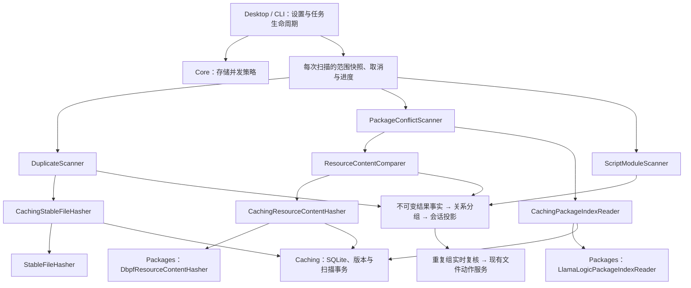

# 扫描性能优化与缓存架构

状态：整文件哈希、package 索引和资源内容已接入统一并发策略；其余状态见[实施计划](性能优化与重构实施计划.md)。原方案代码基线 `f4bb07a30f4c30f283f5e71f88fd0a9e99d781ef`，核对日期 2026-11-17。

输入为《sieve-性能与缓存-Codex任务.md》和《sims4-性能优化计划-1021.md》。历史耗时来自输入文档，本文没有重新测量真实 Mods。任务书引用但未随本次提供的《sims4-评级与检查架构.md》不作为已核实材料；产品判断以仓库的[冲突评级与拆分标准](../product/冲突评级与拆分标准.md)为准。

配套的[实施计划](性能优化与重构实施计划.md)规定交付顺序、改动位置和验收。本文规定长期有效的模块边界和数据契约，实施计划通过链接引用这些规则。

## 1. 已确认的范围与原则

用户已确认：

- 核心先做：重复哈希并发、冲突内容并发、安全减少解压、整文件缓存、资源缓存。
- 共用扫描清单、结果模型优化、xxHash、头尾预筛和游戏本体索引全部纳入总架构，分别作为后续阶段，不随核心五阶段一次交付。
- 扫描缓存默认关闭。接受文件内容改变而长度、时间和身份均未改变时暂用旧结果，删除前必须绕过缓存实时复核。

性能重构保持现有检测业务语义、页面归属、选择规则和会话生命周期。不得借优化改变冲突评级、资源排除类型、合集证明门槛、建议保留逻辑，或擅自扩大到日志分析、健康检查和二分排查。

扫描与缓存只读 Mods、备份和游戏目录。新增缓存、日志、临时数据库和隔离的坏缓存文件只写工具数据目录；只有用户明确发起的文件动作沿用现有删除、禁用和恢复服务。不得在来源目录建立索引、旁车文件、锁文件或临时文件。

## 2. 代码现状与原材料修正

| 主题 | 核实后的代码现状 | 对方案的影响 |
| --- | --- | --- |
| 重复检测 | [DuplicateScanner](../../src/Sims4ModSieve.Core/Duplicates/DuplicateScanner.cs)按长度筛选后有界并发哈希，按候选顺序归并 | 桌面端、CLI 与后台基准采用[存储并发策略](#41-自动并发) |
| 流式哈希 | [StableFileHasher](../../src/Sims4ModSieve.Core/Duplicates/StableFileHasher.cs)用 SHA-256、前后 FileStamp、变化重试一次；文件流缓冲为 128 KiB | 保留实现及重试语义，用装饰器接入缓存 |
| Package 索引并发 | [PackageConflictScanner](../../src/Sims4ModSieve.Core/Conflicts/PackageConflictScanner.cs)无快照调用默认 clamp(CPU,1,4)，按候选下标收集 | 生产入口使用扫描选项快照，按实际参与根解析 |
| 内容并发与预算 | [ResourceContentLimits](../../src/Sims4ModSieve.Core/Conflicts/ResourceContentLimits.cs)无快照调用默认并发 2、单条存储 64 MiB、输出 256 MiB、总量 long.MaxValue | 原“总预算 4 GiB”已不是当前默认；保留显式有限预算的调用契约 |
| 脚本 | ScriptModuleScanner 已并发，默认 2 | 核心阶段不改 ZIP 解析、模块判定和脚本内容缓存；后续共用清单不能吃掉原归档容错 |
| 实际冲突流程 | MainWindowViewModel.Conflicts 顺序执行 package 索引、资源内容、脚本、整文件重复、会话投影 | 索引与内容优化之外，还要单独测整文件核对；当前没有所有扫描器共用的一份枚举结果 |
| 存储诊断 | [WindowsStorageProfile](../../src/Sims4ModSieve.Desktop/Services/WindowsStorageProfile.cs)解析实际来源卷并查询寻道惩罚 | 自动策略和同次扫描的计时日志共用查询结果 |
| 索引数据 | PackageResourceEntry 只有 TGI、Ordinal、ContentSize、Compression 和原文；没有 payload 位置、存储长度 | 不能把目前索引摘要当作可直接定位资源的完整缓存 |
| 资源定位 | [DbpfResourceContentHasher](../../src/Sims4ModSieve.Packages/DbpfResourceContentHasher.cs)自己复核 header/索引并按物理位置读取，定位结构是私有类型 | 原始字节捷径需要明确的新定位边界，不能旁路现有校验 |
| 内容证据 | ResourceContentResult/Occurrence 的成功以 SHA-256 非空为依据；子组按 SHA-256 分 | 不得给“只看大小”或压缩数据哈希填一个伪造 SHA-256 |
| 删除安全 | [FileActionService](../../src/Sims4ModSieve.Desktop/Services/FileActionService.cs)已对带 ExpectedSha256 的待删文件实时哈希，前后复核戳与身份 | 任务书“现在只比戳”的现状已过时；新增的是整个受影响重复组的复核，特别是保留文件 |
| UI | ConflictPage 已用 Recycling 虚拟化；已有 ConflictPageVirtualizationTests，含大量卡片和明细 | 后续重点是数据模型、惰性明细和增量投影，不能把“加虚拟化开关”当成果 |
| 持久化 | 设置、管理记录用 JSON；没有 SQLite 扫描缓存 | 缓存独立存储，不迁移现有用户设置和文件动作历史 |
| 依赖 | .NET 10；LlamaLogic.Packages 4.9.0、SharpZipLib 1.4.2 | 读取器部分注释仍写 3.8.2；实现前核实实际版本行为，不把旧注释当验证结论 |

历史瓶颈：重复检测 3588 文件、21.9 GB、总耗时约 50～67 秒，哈希占 98.9%；冲突检测 1398 文件、10.4 GB、总耗时约 19 秒，内容约 78%、会话与结果行约 2 秒。它们用于选择方向，不能当作当前版本性能基线，也不能承诺优化后秒数。

## 3. 目标结构与依赖

并发策略和默认关闭的 zlib 代表复用已实现；图中的持久缓存、共用范围快照和删除整组实时复核仍为目标能力。

| 位置 | 职责与边界 |
| --- | --- |
| Core/Duplicates、Conflicts、Scripts、Packages | 纯业务、读取接口、结果模型、安全限制；不引用 WPF、SQLite、LlamaLogic 类型 |
| Core 中的存储策略 | 识别结果到并发上限的纯函数；平台查询接口只表达 SeekPenalty/Unknown，不暴露 Win32 句柄 |
| Packages | DBPF 定位、索引、字节读取、支持的流式解压；持有所有格式可信度判断 |
| 新增 Sims4ModSieve.Caching | 三种装饰器、SQLite 实现、版本元数据、缓存会话与故障降级；引用 Core，不引用 Desktop；数据库层不猜 DBPF |
| Desktop/Services | Windows 存储检测、设置与数据目录、缓存管理界面、重复组操作复核、服务组合 |
| CLI | 默认继续可无缓存运行；后续显式接并发/缓存选项，使用同一策略和装饰器，不引入 WPF |

独立 Caching 项目的理由是三种缓存要共用数据库与生命周期，同时不让 Core 引入 SQLite。新增依赖仅放在这里，测试使用独立临时目录。阶段 3 的定位和读取协作优先留在 Packages 内部；只有 Core 确需调用的最小数据契约才公开，不提前建设通用文件系统框架或通用插件系统。

组合使用显式工厂或现有构造器注入。Desktop 必须同时覆盖独立重复检测和冲突中的整文件重复核对；CLI 不得因 CreateDefault 遗漏新策略。设置在开始扫描时固定成不可变选项，本次扫描中修改设置只影响下次。底层真实读取器保留为可直接调用的无缓存路径。

## 4. 并发、顺序与取消

### 4.1 自动并发

`IStorageProfile` 返回实际来源卷的寻道惩罚、未知原因与稳定卷标识。Windows 实现从来源目录句柄解析卷 GUID，再用 `StorageDeviceSeekPenaltyProperty` 查询。自动档按本阶段实际参与读取的目录探测：索引取发现文件的遍历根，整文件哈希取长度筛选后的候选遍历根，内容取已建立批次的 package 所在目录。探测发生在发现或合批后、启动 worker 前；同次扫描共享画像，只在协调线程访问，寻道惩罚按实际卷合并并供诊断复用。无法解析实际卷或读取设备属性时采用未知档。

| 设置 | 规则 |
| --- | --- |
| 自动：全部来源确认无寻道惩罚 | 整文件哈希上限 4；package 索引与资源内容上限 min(逻辑 CPU,8) |
| 自动：至少一处有寻道惩罚 | 上限 1 |
| 自动：无已知 HDD，但至少一处未知 | 上限 2 |
| 手动 1 / 2 / 4 / 8 | 使用该上限；“HDD 不退化”验收针对自动模式，手动高并发不冒充自动策略收益 |

“跨盘取最保守”是全局上限，不是每个卷各开 N 个任务。只统计启用且实际参与读取的来源；联接目标、挂载卷、无法对应实际卷的路径要重新解析或归未知，不能只按盘符推断物理设备。无法证明两个盘符独立时不叠加并发。

`ConflictScanOptions` 在扫描开始时固定并发档位与本次存储画像。Desktop 的索引和内容请求共用同一快照，整文件核对使用相同档位与画像；CLI 读取已保存的 `HashConcurrency`，没有可读设置或值无效时用 Auto。CLI 链接平台探测源码，不引用 WPF；Linux 返回未知。设置页名称为「扫描并发」，旧绑定 `DuplicateHashConcurrency` 和保存键 `HashConcurrency` 保留；范围说明放在标题右侧可键盘聚焦的 info 图标 Tooltip 中。脚本上限保持 2。

不带快照的旧调用保持索引 CPU 默认值和内容默认 2。索引显式 `MaxDegreeOfParallelism` 优先于快照；内容显式覆盖由 `ResourceContentComparisonRequest.MaxDegreeOfParallelism` 表达，不需要用新的 Limits 重建安全配置。不限总量时只用 `with` 替换 Limits 的并发字段，其余字段保持原值。

`ScanConcurrencyDecision` 记录阶段、请求档位、策略上限、采用上限、存储分类及回退原因。在 worker 启动前同步写入性能日志；CLI 同时写标准错误。空阶段无 worker，不产生并发决定。手动档不探测硬盘，存储分类为「未探测（手动）」；未知卷采用保守策略。配置上限不等于实际活跃任务峰值。

有限内容总预算（`MaxTotalProcessedBytes < long.MaxValue`）时，即使有快照或显式内容覆盖，也保留原 Limits 的内容并发（默认 2，原值 3 等非设置档位也保留）；索引阶段仍可按存储策略执行。原始字节代表复用在此模式旁路，后续资源内容缓存也须旁路。该兼容模式记录实际选值与原因，避免为提速改变预算耗尽时哪些资源未完成。原并发调度的不确定性见第 8 节。

### 4.2 确定性与进度

- 候选排序保留现有顺序。并发任务按候选下标写独立结果槽，成功或失败只写一次；结束后按原顺序归并。
- 不并发写 List、排序键或业务模型。不让完成顺序决定 issues 顺序、组号、建议保留或相同内容子组的顺序。
- 使用有上限的 Parallel.ForEachAsync，不为全部文件创建 Task；每条流沿用有界缓冲和顺序读。
- 完成数包含成功和失败，成功哈希数单独统计。进度报告加锁或单消费者归并，完成数单调，阶段序号和扫描 generation 一起校验。
- Desktop 可以合并高频进度通知，但阶段切换、最终完成和取消不可丢失。不能在 IO worker 直接改 WPF 绑定集合。

### 4.3 取消契约

取消传给枚举、排队、读块、解压、数据库等待和写入；等待所有已启动 worker 退出后，才能释放扫描上下文。不得报告 Completed 或发布半份新结果。取消不变成普通 issues，不吞 OutOfMemoryException。

LlamaLogic 的 FromPathAsync 目前没有 CancellationToken；只能在进入前后检查，不能宣称“立即中断所有解析”。阶段 0 要测这个不可取消窗口；若窗口不可接受，单列有界解析替代任务，不能靠 Task.Run 伪造取消并留下后台读写。

## 5. 减少资源解压的正确性边界

### 5.1 声明大小不构成已验证内容证据

原材料建议“解压大小独一份就不解压”。当前 ContentSize 未与真实输出验证，且可缺失；坏 zlib、截断、RefPack 不支持、错误长度都可能直到内容读取才发现。按声明大小直接判定不同，会把原本未完成的资源变成成功结果。

核心阶段 3 因此采用以下裁决：

1. 大小只用于候选桶和安全上限检查，不作为独立成功子组证据。
2. 完整成功结果仍包含实际输出长度和解压后 SHA-256；不改变 ResourceContentResult 的成功定义。
3. “按大小跳过”的日志字段可以增加，但当前安全实现值为 0，并记录不具备已验证长度证据。不得为了计数非零削弱校验。
4. 将来若已有该文件版本的成功资源缓存，可以复用其中已验证的长度和哈希；收益归资源缓存，不冒充无证据的大小捷径。

若未来改成无哈希的关系证据模型，必须另做公共契约迁移，同时处理 HasConfirmedDifference、HasConfirmedIdentical、Uncompared、文件对与包含证明；它仍不能解决声明大小不可信的问题，因此本轮不采用。

### 5.2 压缩数据相同的代表复用

`ConflictScanOptions.ContentReuse` 是本次扫描快照的 Off/Auto/On 模式，生产默认 Off，旧调用也走完整原 reader。不新增设置、不持久化。有限总预算始终旁路；Auto 复用必须确认所有参与目录为 SSD；并发选 Auto 时，即便复用请求 On，遇到 HDD/未知仍旁路。手动并发加 On 是人工实验请求，可在没有介质探测时启用。旁路原因写诊断。

第一版只优化 zlib（实际编号 `0x5A42`），None 继续原路径。身份仍为 package 路径、FileStamp、TGI、Ordinal，定位描述符不进入公开索引或持久存储。

1. 有界包 worker 复核当前戳、header、索引形状、ordinal/TGI、范围和原单条上限，复用原 reader 的同一校验函数。
2. 按同 TGI、实际压缩编号、存储长度、声明输出长度成桶。单成员直接原路径；多成员按包和物理位置指纹预读，摘要只筛候选。
3. 摘要相同后完整分块逐字节确认；碰撞会拆成不同实际字节集合。稳定路径顺序、Ordinal 选择代表，不由任务完成顺序决定。确认串行协调；并发≥2 时最多两个包句柄，并发1时逐块交替打开、核对版本和关闭两侧。
4. 确认阶段结束后，有界包 worker 读取代表及不能复用的资源。代表走 `HashAsync` 原 reader，重新执行 precheck、目标/版本核对、解压、校验和、输入耗尽、实际长度与 SHA-256 验证。
5. 仅暂存代表真实内容哈希和实际长度；不同原始字节独立解压，后续仍按内容哈希合并，允许不同 zlib 级别及 None/Zlib 同内容合并。
6. 代表失败或成员预读失败，各自回原路径。需要回退的成员包完整重读本批 targets，保留原包级失败边界；已发生读取与解压计数不撤回。
7. 发布前复核全部包版本。失稳包整批作废；健康包中依赖该代表的成员撤销并整包回退。依赖只有“成员→直接代表”，无代表链；新失稳包只会增加，回退包最多完整重读一次。未确认稳定的结果不发布。
8. 取消贯穿每阶段及块读取，等待 worker 退出，释放流/缓冲/预留额度，不返回半份结果。返回 Core 前显式释放指纹、描述符和依赖引用，不改变 #54 分组规模公式与系数。

描述符窗口最多 131,072 个请求或资源目标，超限整轮旁路；每个摘要桶最多保留 32 个不同实际字节代表，超限成员走原路径；逐字节确认的逻辑输入上限 32 GiB，比较前预检剩余额度，超限只失去优化机会。资源 payload 不全量驻留，不建立两两矩阵。

不限总量也如实扣减指纹实际输入、确认两边实际输入、原 reader 及回退输入、实际输出；读取前预留，按实际字节结算，不扣虚构的成员输出，不退回失败/撤销前已消耗的量。header/索引读取沿用原预算口径，不计 payload 预算。

该路径增加打开、元数据与 payload 重读成本。Windows SSD 正收益尚待 Off/On 实测；少解压而更慢时仍保持默认 Off。原材料“大小独特直接成功”的方案不采用；大小只筛复用桶。

### 5.3 计数与原始统计对照

`ResourceContentReuseDiagnostics` 同时写入 ScanPerformance、CLI stderr 和基准的内容阶段指标；`summary.json.runMetrics` 不含大业务快照，便于汇总。

- `NeedsDecompressionResources` / `DeclaredOutputBytes`：本轮实际 zlib 编号、范围与单条上限合格的 occurrence/声明输出总量，包含坏 zlib；不含 None/不支持压缩/提前拒绝者，与 raw-reuse-stats 分母一致。旁路时由原 reader 记录。
- `FingerprintedResources` / `FingerprintPreReadBytes`：成功生成摘要的条目数 / 指纹实际输入（失败前读到的量也计入）。`DigestCandidates` 为实际开始的摘要命中比较数，`ConfirmedComparisons` 只计完整字节相同。
- `Representatives` 是指纹后独立走原 reader 的稳定候选代表数量；`EquivalentSets` 只计最终成功复用的集合。`SavedDecompressions` 是最终发布且实际省去解压的成员数；`SavedOutputBytes` 为这些成员对应的代表真实输出长度之和，原始摘要不进入公开 Sha256。
- `GrossAdditionalReadBytes` = 指纹输入 + 确认两侧输入；`AvoidedOriginalReadBytes` 为最终省去的原路径输入；`NetAdditionalReadBytes` = 毛额 − 省去输入，和 raw-reuse-stats 成本模型同口径。统计工具估算确认量，生产记录实际量；碰撞、短路、失败与回退时二者会不同。失败回退造成的原 reader 重读另体现在实际输入/解压次数中。
- `FallbackResources` 计失去复用机会或整包回退涉及的合格 zlib 目标；`RevokedResources` 计已确认依赖因版本/预读失稳撤销的成员；不能把确认过但后来回退者继续算跳过。
- `ActualInputBytes` / `ActualOutputBytes` 为所有实际 payload 输入/输出，含 None、失败前输出与额外读取；二者之和等于本轮内容预算消耗。不是物理磁盘 IO。解压尝试/成功计已发生工作，失稳后不抹掉；“按大小跳过”恒为 0。

## 6. 缓存设计

### 6.1 存储选择

选择本机 SQLite，使用 Microsoft.Data.Sqlite。理由是三种持久化数据需要并发读取、原子提交、索引查找和崩溃恢复；多份 JSON 的全量重写及跨文件提交会扩大自研一致性代码。

缓存根为 `%LOCALAPPDATA%\Sims4ModSieve\cache\`；Linux 测试或 CLI 使用平台 LocalApplicationData 对应工具目录，测试必须显式注入临时根。缓存目录放在本地工具目录，不能把 SQLite WAL 放在网络扫描来源上。

阶段 4 实施时选择支持 .NET 10 的稳定版本并固定，不在设计稿里虚构已验证版本。核实 Microsoft.Data.Sqlite、SQLitePCLRaw 和 SQLite 原生库的实际许可证及传递依赖；更新锁文件、THIRD-PARTY-NOTICES、许可证分发和 win-x64 发布验证。当前仓库尚未增加这些依赖。

### 6.2 版本和键

元数据包含 CacheSchemaVersion、HashAlgorithmId、PackageParserRulesVersion、IndexProjectionVersion、PathKeyVersion 和配置签名。任一不兼容版本变化，切换整个缓存 generation 并重建；程序显示版本变化不必无条件失效，但解析或摘要语义变化必须提升规则版本。

| 数据 | 主键及必要值 |
| --- | --- |
| 文件版本 | generation + 规范化路径 + Length + UTC ticks + 身份是否存在 + VolumeSerialNumber + FileIdLow + FileIdHigh |
| 整文件哈希 | 文件版本 + 算法；值为完整 SHA-256 |
| Package 索引 | 文件版本 + 解析/投影规则；值为当前 PackageIndexSummary 的完整成功信息、资源顺序、TGI、Ordinal、压缩原文、ContentSize、ToolingMetadataTypes |
| 资源哈希 | 文件版本 + 解析规则 + 算法 + TGI 的全部字段 + Ordinal；值为解压后 SHA-256、实际输出长度、经验证的存储长度/压缩信息及安全配置签名 |
| 扫描会话 | scanId、generation、状态、观测范围与完整枚举标记；用于暂存写入和范围清理 |

UInt64 身份和 Instance 不能直接溢出 SQLite 有符号 INTEGER；使用固定长度二进制或定长十六进制，并以同一编码读写。SHA-256 校验长度和编码，长资源清单限制条目数与反序列化长度，不允许缓存损坏造成无界分配。

索引缓存第一版只保存当前公开摘要。payload 的位置/存储长度目前不在该摘要中，资源 miss 仍由真实读取器重新定位；若阶段 3 提取了定位快照，必须另带文件版本与规则版本，验证后才可复用，不能猜造字段。

### 6.3 路径与文件身份

沿用项目现有完整路径、去尾分隔符和 OrdinalIgnoreCase 比较规则；数据库键编码必须与业务 comparer 语义一致，不能直接依赖 SQLite NOCASE 对 Unicode 的行为。用平台一致的路径编码并对原路径做最终比较，测试中文、大小写及根路径，原始展示路径独立保存。

不通过数据库层自行跟随重解析点或合并路径别名。硬链接可拥有相同身份但不同路径，仍保留路径与来源关系。路径忽略、来源归属和建议保留不由缓存键决定。

身份从有值变为无值或反过来视为 miss；无身份的只读扫描允许用 null 身份版本，但不得为文件动作伪造可靠 ID。当前 Linux 物理身份返回 null 是已知行为。网络卷、FAT 等弱文件系统的文件戳只能提供弱失效保证；用户已接受第 1 节的残余风险。

### 6.4 三种装饰器的读写契约

通用顺序：取消检查 → 采集当前戳 → 读取并验证缓存 → 再采集戳 → 命中返回；未命中则调用真实读取器 → 检查最终稳定性 → 只暂存成功结果。

| 装饰器 | 特殊要求 |
| --- | --- |
| CachingStableFileHasher | miss 调原 StableFileHasher，原重试逻辑不变；缓存 key 使用返回的成功 Stamp，不能用最初旧戳写入；命中不读取完整内容，但仍采集前后元数据 |
| CachingPackageIndexReader | 命中还原全部摘要语义；应用当前安全上限和规则签名，不能让旧缓存绕过新限制；戳变化回真实读取器，其异常和取消契约不变 |
| CachingResourceContentHasher | 先比较 ExpectedStamp 与当前戳，不同则整批 Stability 失败；再按目标拆分 hit/miss，miss 合并为同 package 一次底层调用；最终按请求顺序归并，统一复核 package 戳，不稳定则 hit/miss 全批作废 |

资源命中仍验证请求 Targets 及结果一一对应，TGI 相同 Ordinal 不同是不同记录。成功记录可来自阶段 3 已完整证明的代表复用；只按大小推断、失败、预算不足、unsupported、读中变化和取消均不可写入。

资源缓存须核对当前单条限制及解析配置；不能拿旧成功记录替一个当前会拒绝的大资源放行。核心阶段默认总量不限，命中不虚扣 IO 预算；有限总预算调用整体旁路资源内容缓存和捷径，详见第 8 节。

禁止缓存最终冲突分组、忽略列表投影、扫描范围选择或文件动作授权。每次仍用本次来源、过滤规则和设置重建结论；缓存只保存成功读取事实。

### 6.5 扫描事务、并发与崩溃

采用 WAL、本地文件、短写事务、单写入协调器；不跨 IO 持有 SQLite 写事务。每次扫描使用独立 scanId 和有界写入队列，批次先写暂存区，只有状态为 committed 的扫描记录对其他扫描可见。

扫描成功且未取消时，在一个短事务中发布本扫描成功记录与允许的范围清理，提交前最后检查取消。失败或提交前取消：不发布暂存记录，旧 committed 数据继续有效。进程被杀后 SQLite 恢复事务，下一次启动清理 abandoned 暂存；不得把半份 BLOB 当成成功。

提交是线性化边界：取消早于提交检查则不提交；取消与已经完成的原子提交并发，允许保留这批完整有效数据，但 UI 仍遵守取消后的结果发布规则。不能承诺在数据库提交完成后再倒退取消。

并发扫描不互相覆盖 scanId，也不共享可变数据库连接。跨进程用数据库事务与维护锁协调；超出短等待上限就放弃本次缓存写入，不拖住扫描。单实例 UI 当前串行扫描，并不等于缓存可以省略并发安全。

### 6.6 故障与清除

- 打开失败、格式错、integrity/quick_check 异常、记录校验失败：禁用本扫描缓存，记录一次可诊断事件，由维护锁切换 generation 并隔离/重建坏缓存。不能一边读可疑缓存一边继续下结论。
- 若故障发生前已消费缓存结果，整次扫描发布前回退无缓存重算一次；该次禁止缓存读写，防止降级循环。取消直接停止，不触发重算。
- 写失败、只读目录、磁盘满、锁等待超时：放弃本扫描写入，健康的既有读取结果仍可用；若失败表明数据库损坏，则按上一条全扫描重算。
- 不捕获 OutOfMemoryException 继续运行；日志失败不能覆盖原扫描错误。
- 清除缓存以 generation 切换实现；已启动扫描停止使用旧 generation，并在发布前走无缓存回退，迟到写入不得把旧数据复活。清理旧数据库前等待读者释放，不强删打开中的 WAL。
- 缓存大小包含数据库、WAL、SHM 和待清理文件；读取大小失败显示“无法读取”，不是 0。坏缓存隔离文件最多保留一代。
- 初始磁盘维护高水位建议 1 GiB，为实现时可调内部参数；提交后按最近访问淘汰成功记录，不能删除用户管理记录。批次队列与单记录大小有界。满盘或维护失败只降级，不能通过无限缓存占盘。

SQLite 页面检查与记录摘要可识别意外损坏，不能保证同一用户蓄意篡改数据库后仍可信。缓存不是文件真实性、安全软件或删除授权来源。

### 6.7 范围清理与禁用

扫描结束时只清理“本次明确覆盖且完整枚举”的范围、扩展名和扫描能力内，确知不存在的版本。不根据哈希候选、冲突候选或缓存命中清单直接删除未出现记录。

取消、目录拒绝访问、断开网络、关闭某来源、未展开链接和扩展名不匹配均不等于文件消失；这些范围保留旧记录，后续用版本校验或容量淘汰解决。清理要用目录边界判断，不能用字符串前缀误删 Mods2。

禁用/恢复/删除成功后通知缓存失效原路径和目标路径。禁用成 .off 后它不再进入扫描，不承诺“被禁用文件会重读”；应验证未变 package 命中、重新启用文件按版本规则处理。事件漏掉时，下一次实际枚举与 FileStamp 校验仍负责失效。

## 7. 删除前的重复组实时复核

文件动作基础规则继续见[文件操作的扫描快照核对](../release/file-operation-safety.md)。本节规定缓存带来的额外组级证据要求。

缓存结果不能授予删除权限。为避免来源标记丢失时漏检，方案统一对重复组动作执行整组实时复核，不仅对已标记为命中的文件复核；不依赖界面控件临时记住“这个 hash 来自哪里”。

1. 操作请求携带不可变重复组快照：原组 SHA-256、全部文件路径与戳、用户选中集合、扫描 generation；重复页、冲突重复卡、批量和单文件入口统一使用。
2. 在确认后的实际执行阶段，绕过全部缓存，用真实 StableFileHasher 对该组所有文件计算 SHA-256，包括建议保留和手动未选中的文件；每份必须仍对应扫描版本，且哈希等于原组哈希。
3. 只要一份不一致、读取失败或身份不可用，拒绝该组所有待删文件，提示重新扫描；其他互不相关的组可继续。组复核期间不得先删除组内任何成员。
4. 全组内容通过后，沿用现有候选最终戳/身份复核、回收站支持检查、文件动作历史和部分结果处理。避免随后再哈希待删文件一次，重用本次组复核证据，但不能删掉最后元数据检查。
5. 全组选中是现有显式确认能力，不擅自强制留一个；仍对整组验证。若用户只选一个文件删除，也要验证同组保留成员，不能只看被删文件仍等于旧哈希。
6. 取消在调用回收站前不执行动作；系统动作已经发生时如实返回已完成部分，不能声称事务回滚了用户文件。

普通资源冲突的删除/禁用不以“重复”为理由，继续使用现有文件戳与身份检查，不声称整文件哈希能够替代冲突内容重新分析。若将来添加“依据缓存关系自动操作”的功能，须另定义复核，不能复用本方案默认放行。

最后一次核对到按路径系统操作之间仍有 TOCTOU 窗口，见现有安全文档。本方案缩小窗口，不承诺能够阻止有权限的并发进程在最后时刻替换文件。

## 8. “结果一致”的精确定义

两类对比：

- **稳定输入**：同一文件快照、相同来源/规则/安全上限，缓存关闭和开启、串行和并发、捷径开启和关闭的业务结果一致。
- **异常输入**：失败归属、错误码、未完成资源和版本不稳定处理保持保守。人为制造“内容变但戳不变”的缓存陈旧例外已获用户接受，单列用例，不能混进稳定输入的通过率。

比较内容包括：重复组 SHA-256、成员、顺序、建议保留/删除、来源归属；TGI 子组真实哈希及成员；文件对相同/不同/未完成计数；包含证明、v2 关系与卡片顺序；脚本模块结果；被排除文件与 issues 的稳定字段。不比较扫描时间戳、耗时、缓存命中来源、进度通知次数、实际读字节和实际预算消耗。

原始字节复用故障按路径、目标及逻辑阶段注入；新增读取改变时间窗口，不能用“第 N 次 Read”跨路径硬对齐。版本变化的最终整包作废与依赖撤销必须保持保守。

涉及读失败时缓存命中可能避开原 payload IO，不能承诺“历史可读的未变文件后来只禁止内容读取”会得到和强制重读一模一样的错误；命中仍做元数据访问检查。对比测试中的故障注入必须说明发生在缓存访问、元数据还是实际内容读取，不能隐去这类可观测差异。

有限共享预算按实际读取和输出扣减，节省解压必然可能让更多资源完成，无法同时保证“省预算”和“完全相同的未完成列表”。本方案不伪造预算消耗：有限预算下退回原内容路径，保留调用者原并发（默认 2），继续运行预算边界测试。原路径并发超过 1 时，在极小共享额度下也存在任务竞争，不承诺特定文件必然先失败；测试验证总量不越界、无假成功、结果归属正确。若产品未来要求稳定的额度分配，必须单列确定性预算调度变更。

## 9. 设置、诊断与性能口径

设置保存并发 Auto/1/2/4/8、缓存 Enabled（默认 false）。旧设置缺字段取默认值；所有既有保存入口必须保留新增字段，不能更改 Mods/Tray 时意外重置。扫描中固定选项快照，缓存清理异步执行且展示执行结果。

计时继续使用 [ScanPerformance](../../src/Sims4ModSieve.Core/Diagnostics/ScanPerformance.cs) 与[现有口径](扫描性能计时.md)，新增：

| 类别 | 指标 |
| --- | --- |
| 并发 | 设置值、解析后的上限、存储分类、兼容回退原因；配置上限与实际峰值分开 |
| 缓存 | 每类 lookup/hit/miss/bypass、命中字节、写入/失效/故障、整次回退次数与耗时 |
| 捷径 | 原始字节候选数、逐字节确认数、代表数、节省解压次数、额外读取量、按大小跳过数 |
| 资源 | 继续保留失败、实际 IO 输入与输出、预算消耗；cache 命中字节单列，不能伪装成实际读取 |
| UI | 关系构建、行投影、Dispatcher 绑定、首屏布局提交、可视容器数量、展开/筛选耗时 |
| 生命周期 | 取消请求至 worker 退出、数据库提交与清理、峰值工作集、GC 分配和句柄峰值 |

不得在并发 worker 内创建未协调的顶层 Stage，破坏现有 stages 集合与父子关系。阶段墙钟、线程累计和嵌套阶段不能相加冒充总耗时。诊断路径沿用现有脱敏，不在日志输出用户文件内容。

CLI 不创建全扫描计时会话；资源比较器在没有外层会话时创建仅内存的局部会话，向 stderr 回调实际计数，不写日志文件。独立[后台基准驱动](扫描性能基准.md)输出原始阶段日志和一致性快照。

## 10. 后续重构与扩展

### 10.1 共用扫描清单

当前 SourceFileDiscovery 逻辑已复用，但每个扫描器仍各枚举一次。后续增加一次扫描内的不可变清单，含规范路径、来源关系、发现戳、类型、链接问题和枚举完整性。重复、package、脚本各取所需视图；仍在实际读取前复核文件版本。

清单只在一次任务内复用，不跨重复页/冲突页共享可变选择或结果；不是持久化快照，也不复用上次扫描的枚举。先以现有扫描器作外壳，提供兼容入口，再替换冲突编排中的重复枚举。缓存装饰器不依赖该重构。

### 10.2 UI 数据模型与投影

保留现有按文件关系分组、技术明细与虚拟化结构。将稳定扫描事实、关系图、用户选择/忽略/展开状态、可见行投影分离；事实不可变，选择与视图只在会话中管理。

避免每次筛选、勾选或展开重建全部关系，技术明细按展开构造并按会话版本缓存；快照 generation 与请求序号防止旧投影覆盖新选择。回收容器不能成为选择真源，状态用稳定行键定位。

高共享 TGI 的文件对展开可能接近平方复杂度，需要观测边数、构建耗时和内存；不截掉边伪装无冲突，也不为提速改变业务分组标准。数据虚拟化如确有必要另做兼容设计，不能破坏全选、批量、滚动恢复和键盘操作。

### 10.3 xxHash 与头尾预筛

SHA-256 保持核心阶段的算法。若后续证实 CPU 哈希占比值得优化，再引入带算法 ID 的摘要类型与 System.IO.Hashing；xxHash 相同必须完整逐字节确认后才构成“重复”，强制碰撞测试不可省略。

当前 Group.Sha256、JSON/HTML、ignore key 依赖、删除候选 ExpectedSha256 都需审计。不得把 xxHash 填进 Sha256 字段；旧报告仍可读，动作侧保留真实 SHA-256 或明确的全内容证明，不用快速摘要授权删除。算法迁移提升缓存版本。

头尾预筛只排除大小相同但采样不同的候选；采样相同仍必须全量比较。短文件避免重叠读，前后文件戳核对、读失败和取消与主哈希一致；HDD 随机读可能倒退，默认关闭，以实际节省的全量读取量决定是否采用。

### 10.4 游戏本体索引（#28）

复用缓存引擎，另设 GameCatalog 命名空间；键包含安装根、游戏/补丁版本、DLC 集合与各包文件版本、解析规则。不能只用一个游戏版本字符串，因为维修、DLC 变动和部分更新也会改文件。

完整目录事务成功后才发布新 catalog；更新期间保留上一已完成代并标记过期，过期数据不作为确定的新版本结论。保留前后两代支持资源变更检测；缺少基线表示无法判断变化，不能判“未变”。

本体目录全程只读。内容存储优先资源键和必要摘要，不缓存版权 payload。覆盖原版、更新后可能失效、Tray 依赖等能力按产品标准分别接入，#28 是基础数据能力，不把相关健康检查一并视为完成。

## 11. 回退与验证责任

所有性能开关回到“并发 1、无缓存、无捷径”时应能运行真实读取路径。资源有限预算另保留调用者原并发（默认 2）的兼容模式；不将两者混作同一基线。缓存默认关闭，捷径独立可旁路，数据库是可删除的派生数据。

任何语义不一致、错误成功或删除复核遗漏先关闭对应优化；不通过放宽断言、改错误码、删失败资源或跳过测试解决。核心步骤按独立 PR 交付，不直接推 main；本次文档交付不创建实现分支、不提交 Issue 或 PR。

Core、Packages、缓存存储和 CLI 的逻辑验证可在 Linux 云端完成；Win32 卷识别、真实文件身份、WPF/STA、回收站、安装版和 Windows 真盘性能必须在 Windows 验证。可执行的测试与基准矩阵见[实施计划](性能优化与重构实施计划.md)。
