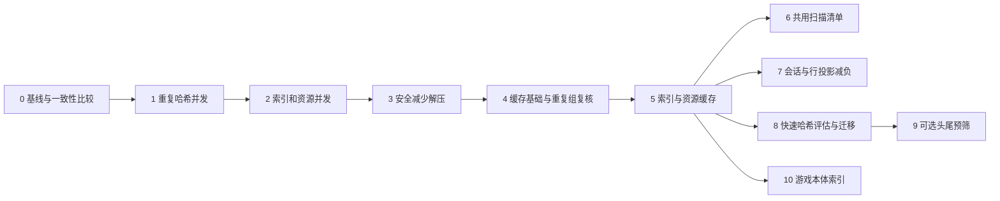

# 扫描性能优化与重构实施计划

状态：阶段 0 基准工具已完成。阶段 1 的实现、逻辑测试和 Windows SSD 对比已完成，HDD 性能验收待补。阶段 2～10 待实施。原方案代码基线 `f4bb07a30f4c30f283f5e71f88fd0a9e99d781ef`，日期 2026-11-17。

技术契约见[扫描性能优化与缓存架构](性能优化与缓存架构.md)。除明确标记完成的阶段 0 工具外，下面的类、开关、测试和性能收益仍是实施任务。

## 1. 交付范围与依赖

核心五阶段按原任务书顺序，阶段 0 先建立可用基线和对比工具。每个核心阶段一个独立分支和 PR，前一阶段合入、证据通过后再开始下一阶段；不直接推 main。阶段 4 包含缓存基础、整文件缓存和删除安全，不能把其中一个未完成时称为“缓存可用”。



阶段 6～10 的先后由核心完成后的新计时确定。图中分叉表示逻辑依赖，不授权多 Agent 或并行修改同一代码。游戏本体索引接 #28 单独评审，UI 不等待换哈希才可优化；头尾预筛即使不换哈希也可做独立实验。

## 2. 开工约束与当前交付物

- 每阶段开工先读 AGENTS.md、检查工作树和最新 main，核对本计划涉及的接口。保留用户及其他人的未提交变更，不创建不必要的 worktree。
- 实施期间只改对应阶段所需文件；任何业务语义变更单列 PR，不能藏在性能 PR 中。
- 每阶段补充相关测试，用类名筛选执行；准备合并时按仓库规则跑一次整套 Windows 测试。文档修改不跑测试。
- 真实 Mods 仅用于只读性能扫描，文件动作验证只用自动创建的临时样本。不得把真实 Mods 上传云端、提交仓库或用于删除测试。
- SDK 以 global.json 为准；当前固定 10.0.403。还原用 locked-mode，代码实施确需新增依赖时有意更新相关锁文件及许可证。
- 构建要求零警告、零错误。性能改动必须同时有结果一致性证据与计时证据，二者不能互相替代。

已有基线代码可定位到[架构现状表](性能优化与缓存架构.md#2-代码现状与原材料修正)。阶段 0 工具的运行和输出口径见[后台扫描基准](扫描性能基准.md)，未修改扫描业务算法。

## 3. 阶段 0：建立可重复的基线

**目标**：把历史“慢在哪”转换为当前版本可复现的证据，先发现现有排序、预算或取消差异，避免把老问题算作新回归。

已实现：独立后台基准入口、业务结果比较、合成 DBPF/脚本样本、输入元数据清单、逐轮原始日志/JSON、中位数、取消和失败记录。云端验证这些能力；Windows SSD/HDD 与 UI 基线保留为本地待办。工作集目前记录进程生命周期峰值，句柄只记录起止值，不冒充单轮精确峰值。

工作：

1. 冻结样本清单：文件数量、总字节、扩展名、来源与目录深度、TGI 数、候选资源数、脚本模块数；用样本集 ID 标识，不在 PR 暴露用户路径。
2. 建立结果规范化比较器。比较字段和排除字段严格按[架构第 8 节](性能优化与缓存架构.md#8-结果一致的精确定义)，不能只比“总组数相同”。
3. 使用现有 ScanPerformance，补最小诊断入口，使 CLI 或独立基准驱动能获得后台阶段计时；UI 渲染仍在 Windows 实际窗口测量。
4. 保存基线原始日志及三次中位数。首先验证同一版本重复运行结果本身稳定；极小有限预算允许只验证不越界与保守失败，不假定特定完成顺序。
5. 记录取消延迟，特别标明第三方 FromPathAsync 的不可取消区间；测峰值工作集、分配和句柄数。
6. 准备可控的临时 DBPF、脚本、同内容不同压缩、坏 zlib、同戳替换与读取失败样本；不提交真实玩家 Mod。

直接影响：Core/Diagnostics/ScanPerformance.cs、相关现有测试和独立诊断入口。新实验驱动只提供基准输入/输出，不顺便重构扫描业务。

验收：同样本三次结果通过规范化比较；阶段规模、耗时和计数口径可解释；SSD 和 HDD 真机至少各保留一份当前基线，未取得时明确标为待 Windows 性能验收。

## 4. 阶段 1：重复检测按存储选择并发

### 改动

| 位置 | 任务 |
| --- | --- |
| Core/Duplicates/DuplicateScanner.cs | 有界 Parallel.ForEachAsync、固定下标结果、顺序归并；保留长度筛选与建议保留 |
| Core 存储策略 | 最小 IStorageProfile 契约与纯并发策略，Auto/1/2/4/8；未知来源降级 |
| Desktop/Services/SettingsSupportService.Performance.cs | 提取 Windows 寻道惩罚查询，共用诊断结果 |
| Desktop 的运行服务与设置 | DuplicateRunService 注入本次选项；保存并发设置；独立重复页和冲突内重复核对均生效 |
| CLI-1 并行工作 | 生产 CLI 的显式并发选项由 CLI-1 负责。Core 在调用方没有提供卷探测时按未知卷处理 |

### 必须保留

StableFileHasher 的流式 SHA-256、前后戳核对与一次重试不变。现有 FileChangedDuringHashException 与普通 IO 失败仍各自成 issue。吞取消、按完成顺序生成业务结果和把所有文件读进内存均不得接受。

### 测试与验收

在现有 DuplicateScannerTests、StableFileHasherTests、DuplicateSelectionServiceTests 上扩展：

- 并发 1/2/4/8、强制反序完成，完整结果与顺序相同。
- 仅一个候选读失败，只影响该候选；进度完成数仍覆盖它。
- 排队中、哈希读块中、重试等待中取消，已启动工作均退出，不返回完成报告。
- 多来源混合 SSD/HDD/Unknown，跨盘取最保守；手动档正确；空来源不制造除零或假进度。
- 设置旧文件缺字段取 Auto，改 Mods/Tray 后仍保留并发值；不同入口使用同一设置。

性能比较同样本串行 vs 自动、手动 4 与 8。SSD 阶段中位耗时下降 20% 作为初始目标而非已测承诺；8 未稳定胜过 4 不提升默认值。自动 HDD 不能有可重复退化，判定方法见第 10 节。

退出条件：结果、取消、安全和设置测试通过，Windows 卷探测验证通过，并取得相同样本的前后日志。无真盘证据时可称“实现和逻辑已验证”，不能称“性能目标达成”。

阶段 1 基线为 `eb0c4ca`。Windows 实测确认直接路径与跨卷联接下的路径解析到同一目标卷。真实 Mods 加备份的三轮完整结果与串行基线一致。该样本的 SSD 自动档哈希中位耗时下降约 70%，具体开销见[验收记录](#102-判定)。HDD 与网络卷实测待补。

常规桌面测试覆盖同卷联接和路径缺失。真盘测试需要将 `SIMS4_MOD_SIEVE_STORAGE_PROBE_TEST_ROOT` 设为本地支持寻道惩罚查询的现有可写测试目录，按类名筛选 `LinkTargetScanTests`。跨卷用例要求该目录与系统临时目录位于不同的实际卷。单卷机器可单独筛选 `StorageProbeReturnsSeekPenaltyOnSupportedVolume`。

## 5. 阶段 2：统一 package 索引与内容并发

工作：

1. 查明并记录默认值：索引为 clamp(CPU,1,4)、内容为 2、脚本为 2；去掉 Desktop 调用链中各自猜测并发的逻辑。
2. 包装一次扫描的选项快照，给 PackageConflictScanRequest.MaxDegreeOfParallelism 和 ResourceContentLimits 明确传值；保留原有安全上限。
3. 自动 SSD 用 4、HDD 用 1、未知用 2；有限总预算的内容路径采用[兼容策略](性能优化与缓存架构.md#41-自动并发)。
4. 继续按 package 合批、包内按物理位置读取；不把 package 数并发误改成每个资源各开任务。
5. 日志区分请求上限、实际采用值、有限预算回退原因。脚本保持原并发，UI 说明覆盖范围。

实测结论（SSD，1376 文件 / 9.65 GiB，每档三轮中位数，系统缓存未清）：旧调用 18.5 s；2/2 20.0 s；4/4 14.0 s；8/8 11.3 s，工作集峰值 216→222 MiB。据此自动档下全 SSD 的 package 索引与资源内容改为 min(逻辑 CPU, 8)；整文件哈希未在本轮测 8，仍为 4。HDD、未知卷、少核机器的实测待补。

测试：ResourceContentComparerTests、ResourceContentBudgetTests、PackageConflictScannerTests/BoundaryTests、ConflictScanIntegrationTests、Desktop 的 ConflictScanFlowTests。

验收：不限总量时各并发完整分组、文件对、未完成清单与基线一致；finite 模式不越额、不伪成功；同一 Windows 样本 2→4→8 的耗时及内存比较齐全，选择有证据的默认值，不以 CPU 核数代替存储测量。

## 6. 阶段 3：安全减少解压

> **状态（2026-11-20）：实测无收益，不做。** 实现见 PR #59（未合并，分支 `perf/phase3-reduce-decompression` 保留供参考）。
>
> - `raw-reuse-stats` 在真实样本（1,376 个 package / 9.65 GiB，仅 Mods）上统计：需解压 59,694 条，可省 30,072 次（50.4%）、5.07 GB 输出（63.6%）；额外读取净额约 2.35 GB。
> - 第一版（c646525）Windows SSD、并发 8，Off/On 交替各 3 轮：内容阶段中位 6.42 s → 44.50 s（逐字节确认串行且每对比较重开两个文件）。
> - 修复版（02bf69a，确认并发 + 按包句柄复用）：Off 内容 6.16 s / 总 10.83 s，On 6.78 s / 11.65 s，复用跳过 16,472 次解压，**On 慢 0.81 s（7.5%）**。
> - 结论：在多核 SSD 机器上，省下的解压被原始数据指纹、逐字节确认和额外读取完全抵消。弱 CPU + SSD 理论上可能有收益，但没有数据支持，不为此保留约 1,500 行生产代码。以后若资源缓存（阶段 5）改变了成本结构，可用 `raw-reuse-stats` 重新评估。

### 实施顺序

1. 审计当前 payload 定位和内容成功条件，提取必要的已验证定位描述符；保持 precheck、Ordinal/TGI 与文件版本核对。
2. 在不改变公开 SHA-256 成功模型的前提下，加原始数据指纹筛选和逐字节确认，构建代表复用路径。
3. 代表成功后再填回真实解压后哈希；失败回原路径，跨包失稳全部撤销受影响证据。
4. 保留 original reader 作为旁路。finite 预算和自动 HDD 暂不启用该路径。
5. 填真实“原始字节相同跳过”计数；“按大小跳过”维持 0，并说明声明大小尚非成功证据。

不得直接实施原材料中的“大小独一份直接认定不同”。具体原因、5 份示例的计算修正和代表传播条件见[架构第 5 节](性能优化与缓存架构.md#5-减少资源解压的正确性边界)。

### 测试

- 同 TGI、不同声明大小，其中一份 zlib 损坏：仍是未完成，不能变成不同子组。
- 声明长度相同且完整原始字节相同：减少代表解压，分组、实际内容哈希不变。
- 相同内容使用不同 zlib 级别、None/Zlib：最终仍合并。
- 相同原始字节但声明长度或实际压缩标记不同：不能直接共用代表。
- 注入原始数据摘要碰撞：逐字节检查阻止错误复用。
- 同 package 的多个 ordinal、相同 TGI 的错误目标：不串结果。
- 代表读失败、成员读失败、原始数据确认后文件变化：按契约失败或回退，不传播假成功。
- RefPack、Deleted、Unknown、截断、尾随数据、校验和错误、长度不符、单条/共享预算和取消全部回归。
- 资源和 package 级故障注入后的错误归属与基线对齐；不得把一个成员的故障扩散成全候选组成功或失败。

验收：稳定样本完整业务结果一致；确有等价原始字节时解压减少；额外读取、总耗时和峰值内存有记录。SSD 目标是端到端变快，若“少解压但更慢”，本阶段保留测量结论并关闭该优化，不强行发布默认启用。

## 7. 阶段 4：缓存基础、整文件哈希与操作安全

整文件 SHA-256 存储接入桌面程序、CLI 和基准工具。当前范围见[缓存项目说明](../../src/Sims4ModSieve.Caching/README.md)。重复组存在检查与刷新独立交付，动作侧实时指纹和元数据核对使用真实文件。

### 交付项

| 项目 | 工作 |
| --- | --- |
| 新增 Caching 项目与测试 | 固定 Microsoft.Data.Sqlite 稳定版本；锁文件、原生依赖许可证及 win-x64 分发审计 |
| 数据库与 generation | 元数据、文件版本、成功哈希、扫描暂存及提交时清理同路径旧版本；持久化 scanId、维护锁、容量淘汰和坏库隔离留待后续 |
| 哈希装饰器 | CachingStableFileHasher；不改底层重试；全关时直接使用真实 hasher |
| 故障回退 | 读异常禁用缓存；若已消费命中则全扫描无缓存重算一次；写失败不阻断正常扫描 |
| 重复组存在检查与刷新 | 原操作确认前只对涉及的完整会话组做存在检查；提示后移除缺失成员、不足两份的组和失效选择；非空选择继续原操作 |
| 入口 | CLI `--no-cache`、基准 `--cache enabled`；桌面[缓存设置与清除](../design/设置页面方案-v1.md#缓存) |
| 生命周期 | Desktop 与 CLI 组合、扫描提交、取消和异常收尾 |
| 文档 | 更新现有安全说明、性能口径、主架构“当前状态”和第三方说明，避免两份文档互相矛盾 |

实现缓存键、事务、路径和容错严格依[架构第 6 节](性能优化与缓存架构.md#6-缓存设计)，整组动作依[第 7 节](性能优化与缓存架构.md#7-删除禁用前的结果成员存在检查)。清缓存不能影响设置、忽略、禁用或回收站历史。

2026-11-20 产品决定：删除进回收站可找回、禁用可还原，全组实时读取内容代价高；结果过时应提示刷新，不整组拦截。取消此前实时读取全部成员（含保留文件）的交付要求，具体流程以架构第 7 节为准。

### 必测矩阵

| 场景 | 预期 |
| --- | --- |
| 首次扫描、再次扫描、关闭缓存 | 结果一致；第二次未变候选无 payload 全量读，但仍取戳 |
| 长度/时间/身份任一变化 | miss，重新计算；返回的是稳定新版本的 key |
| 身份 null 与有值互换 | 不误命中；只读扫描可继续，动作侧拒绝无可靠身份 |
| 内容改变而戳不变 | 允许扫描沿旧值；待删成员仍由动作服务实时核对指纹；保留成员内容不在组存在检查范围 |
| 元数据无法访问 | 不用旧缓存静默放行；保持可诊断失败 |
| schema/算法/解析/路径规则变化 | 全缓存失效，旧记录不可读 |
| 库损坏、记录截断、坏摘要、过大 BLOB | 本次无缓存回退，结果正确；无无界分配 |
| 已命中后另一条记录损坏 | 不能混用已读旧证据，重算一次后发布 |
| 磁盘满、只读目录、busy 超时 | 扫描继续，缓存写入放弃并诊断 |
| 两扫描并发、同文件不同版本 | 已提交可见、未提交不可见，版本隔离 |
| 在暂存/提交边界取消或杀进程 | 无半条成功记录、无缓存复活；下次可恢复或回退 |
| 清除与扫描/写入并发（后续） | 旧 generation 写入不复活，已消费旧命中的扫描回退 |
| 来源关闭、断网、拒绝访问、只扫描部分类型 | 不误清其他范围；Mods 与 Mods2 不混淆 |
| 清除大小/容量淘汰（后续） | DB/WAL/SHM 均计入，所有用户管理记录保留 |
| 保留成员不存在、刷新后无待操作项 | 先提示，确认后组消失、选择同步，不弹操作确认框 |
| 缺失成员移除后仍有两份以上 | 刷新后照常确认操作；多组混合只检查涉及的组 |
| 单文件、批量、冲突重复卡、`.off` 成员、全组选中 | 同一存在检查与刷新流程；按记录映射禁用路径；全部存在不提示，全选仍允许 |

验收：缓存开关对稳定结果无影响；第二次命中时跳过文件内容读取；Windows 临时文件安全测试通过；win-x64 原生依赖可加载。

## 8. 阶段 5：资源内容缓存

阶段 5 复用阶段 4 的存储与扫描事务，缓存 package 资源内容哈希。package 索引仍由扫描实时读取。读取限制、稳定性和提交规则见[缓存设计](性能优化与缓存架构.md#6-缓存设计)。

性能比较使用同一份 Mods 加备份，比较资源内容阶段的冷缓存、热缓存及关闭缓存的耗时和快照，逐轮指标见[扫描性能基准](扫描性能基准.md)。

## 9. 后续阶段工作包

| 阶段 | 主要工作 | 开始条件与退出证据 |
| --- | --- | --- |
| 6 共用清单 | 一次冲突任务共用枚举快照；三种扫描器取视图；调用兼容、来源归属和范围问题保持原样 | 核心缓存稳定；枚举次数从多次降为一次，稳定/失败/取消输入一致，扫描中变动仍靠读前后复核 |
| 7 UI 减负 | 会话事实与投影分开、惰性技术明细、局部更新、稳定行键、旧请求丢弃 | 测出剩余 UI 瓶颈；大量行首屏、滚动、筛选、展开、勾选、多选、撤回行为及可视容器边界通过；不改业务分组 |
| 8 xxHash | 先基准，后算法类型与报告兼容迁移；快速摘要候选加完整逐字节确认；动作保留强内容证据 | CPU 哈希仍值得优化；强制碰撞不误判，旧报告字段不冒用，缓存算法版本升级，端到端实际获益 |
| 9 头尾预筛 | 同长度候选读有限头尾，采样不同排除、相同继续完整路径；短文件与采样戳验证 | 高比例“同长不重复”样本有正收益；SSD/HDD 分开测试，无漏报；默认关闭，可决定不交付 |
| 10 本体索引 | 对接 #28；安装/DLC/更新识别，游戏资源目录、按包增量、两代差异与完整提交 | 产品契约确认；版本/DLC/维修/中途取消等矩阵通过；不改写游戏文件，按规范区分覆盖原版与健康检查 |

后续不强制新建 Application/Infrastructure 大层。每次只抽出已证明需要共用的职责；不把 MainWindowViewModel 拆文件数量当成性能收益。

## 10. 基准执行与通过标准

### 10.1 样本和状态

| 维度 | 至少覆盖 |
| --- | --- |
| 文件规模 | 小功能样本、原 3588/1398 文件量级的真实集（可用时）、大合成压力集 |
| 重复率 | Mods+备份高重复、同长但不同、大小大多唯一 |
| 资源形态 | 大包/多小包、不同压缩、重复原始数据、不同存储但同内容、高共享 TGI |
| 存储 | Windows SSD、Windows HDD、未知/网络卷；云端仅负责功能及可重复的合成比较 |
| 缓存 | 关闭、首次建库、热命中、少量文件变化、清库后重扫 |
| 异常 | 坏包、权限/文件消失、戳变化、有限预算、取消、缓存损坏与满盘 |

每个前后条件使用同样本、相同程序配置、相同机器与盘；至少三次，保留全部原始日志并取中位数。交替运行 A/B 降低热机、后台任务与 OS 页缓存偏差。应用缓存“冷”只表示没有 SQLite 记录，不能叫“磁盘冷”；没有受控系统缓存条件就标为未知，不能从用户电脑强制清系统缓存制造数字。

所有后台任务结束、文件句柄释放后再开始下一轮。真实文件被外部更新则作废该轮并重新冻结样本；不悄悄从数据集中删慢文件。

### 10.2 判定

- 语义和安全是硬门槛，任一错误成功、错误删除、取消后发布或不可信缓存结果混入都阻止合入。
- HDD 自动模式不接受可重复退化。三次中位数比基线慢超过 5% 时先作为噪声排查阈值，增加一组交替测量；确认退化即回退，不把 5% 当作允许退化额度。
- SSD 并发、资源捷径和热缓存目标见各阶段。达不到预期先解释瓶颈，不因目标数字启用不安全捷径。
- 冷扫描、峰值内存、句柄峰值和取消延迟都必须上报；有持续内存增长、未释放句柄或额外长时间取消阻塞则阻止合入。
- Stage 时间只比较同口径；缓存命中、候选规模变化、finite 兼容回退必须在日志中可辨。

PR 记录表：

| 样本 ID / 磁盘 / 缓存状态 / 并发 | 基线阶段中位 ms | 新阶段中位 ms | 总耗时中位 ms | 峰值内存/句柄 | 结果差异 | 取消延迟 |
| --- | --- | --- | --- | --- | --- | --- |
| 实施时填写，附三次原始日志 | 待测 | 待测 | 待测 | 待测 | 待验证 | 待测 |

阶段 1 在同一台 Windows NVMe 机器上，每档交替运行三次。`phase1-real` 为 3564 个文件、20,952,798,608 字节的 Mods 加备份样本。基线为 `eb0c4ca`。工作集和句柄列取三轮峰值的最大值，句柄以 50 ms 间隔采样。OS 页缓存状态未受控，所有轮次使用无应用扫描缓存的路径。

| 档位 | SHA-256 中位 ms | 总耗时中位 ms | 峰值工作集 MiB / 采样句柄数 | 业务快照 |
| --- | ---: | ---: | ---: | --- |
| 原版串行 | 50,106.70 | 51,831.59 | 78.9 / 362 | 基线 |
| 自动 4 | 15,103.54 | 16,715.29 | 80.4 / 382 | 一致 |
| 手动 1 | 55,652.24 | 57,363.48 | 79.4 / 350 | 一致 |
| 手动 4 | 14,374.06 | 15,782.55 | 80.4 / 374 | 一致 |
| 手动 8 | 7,330.87 | 8,780.00 | 81.2 / 393 | 一致 |

4096 文件的合成压力集同时覆盖高重复、同长不同内容和唯一长度。SHA-256 中位耗时为串行 3520.57 ms、自动 1909.25 ms、手动 4 为 1819.42 ms、手动 8 为 3033.00 ms。各档业务快照一致，自动 SSD 上限保留 4。

真实样本在进入哈希后发出取消。原版串行和自动档各三轮的取消延迟中位数分别为 4.54 ms 和 6.64 ms，均在 worker 退出后结束且没有写出业务快照。

## 11. 云端与 Windows 的验证分工

| 检查 | Linux 云端 | Windows 本机或 CI |
| --- | --- | --- |
| Core、Packages、CLI 构建与逻辑测试 | 可以 | 可以 |
| 三种装饰器、SQLite 损坏/并发/崩溃恢复 | 可以，临时目录和故障注入 | 还需验证文件锁、清库和 win-x64 原生库 |
| DBPF 捷径和资源边界 | 可以，自造 fixture | 补真实样本只读对比 |
| Win32 寻道惩罚、卷/身份与重解析点 | 只测假的存储画像与策略 | 必须实际平台验证 |
| 设置、WPF/STA、虚拟化、多选与投影 | 不执行桌面测试 | 必须启动实际窗口与行为测试 |
| 重复组存在检查与刷新 | 交叉编译桌面测试，不执行 WPF | 提示顺序、会话和选择同步、真实回收站往返只用临时文件 |
| SSD/HDD 性能承诺 | 云盘结果不能替代用户硬盘 | 必须同盘同样本前后测量 |
| Windows 安装、升级、卸载与原生依赖 | 不能作为运行验证 | 必须执行安装版流程 |

以下命令是实施时的模板，不表示本次已运行。运行前按当前 global.json 激活 SDK，先还原和构建相关项目；`--no-build` 只能在该版本已构建后使用。

Linux 示例（沿用本环境配置时）：

```bash
source /workspace/.sims4-env/activate.sh
cd /workspace/Sims4ModSieve
dotnet restore tests/Sims4ModSieve.Core.Tests --locked-mode
dotnet test tests/Sims4ModSieve.Core.Tests -c Release --no-restore --nologo -m:2 \
  --filter 'FullyQualifiedName~DuplicateScannerTests|FullyQualifiedName~StableFileHasherTests'
dotnet restore tests/Sims4ModSieve.Packages.Tests --locked-mode
dotnet test tests/Sims4ModSieve.Packages.Tests -c Release --no-restore --nologo -m:2 \
  --filter 'FullyQualifiedName~ConflictScanIntegrationTests|FullyQualifiedName~ResourceContentBoundaryTests'
```

Windows 示例：

```powershell
.\eng\dotnet.cmd restore .\Sims4ModSieve.sln --locked-mode
.\eng\dotnet.cmd test .\tests\Sims4ModSieve.Desktop.Tests -c Release --no-restore --nologo -m:1 `
  --filter "FullyQualifiedName~FileActionServiceTests|FullyQualifiedName~ConflictFileActionTests"
```

缓存测试位于 `tests/Sims4ModSieve.Caching.Tests`。真实语料测试通过 SIMS4_MOD_SIEVE_REAL_MODS 注入本机 Mods，按 TestCategory=RealCorpus 筛选。真实回收站测试的显式环境开关和运行方法见仓库 README。

## 12. 合入、回退和待复核事项

每个阶段的 PR 写明：基线 commit、具体代码改动、与原任务书的差异、相关测试执行数量、失败/跳过/未运行、同样本前后计时、Windows 验证状态、开关与回退方法。

回退优先关闭优化开关或回退该阶段独立 PR。缓存不迁移用户文件，删除缓存后应可用真实读取器重建；schema 更新不迁移无价值的派生结果。已经执行的用户文件动作只能按现有回收站/恢复流程处理，不宣称 Git 回退能还原文件。

进入实现前需要再次核实的技术事项：

1. 最新代码是否仍与本基线一致；当前文档中类名和默认值随代码核对更新。
2. Windows 真盘基准是否可取得；缺少数据时可以完成实现，但性能验收保持待办。
3. SQLite 稳定版本及 win-x64 原生依赖许可证和安装版可用性，由阶段 4 实测后固定。
4. 原始字节比较增加读取后的净收益，由阶段 3 数据决定；大小无证据的捷径不作为必做指标。
5. FromPathAsync 的不可取消窗口是否需要独立解析器替代，先测再决定。
6. 后续 xxHash 的报告与动作兼容、#28 的产品契约，在对应阶段开工前单独确认。

用户已经回答的范围和缓存陈旧风险不重复询问。若新证据要求放宽业务一致性、默认打开缓存、改变删除边界或扩大健康检查范围，必须先提出具体差异，不能由实现者自行决定。
